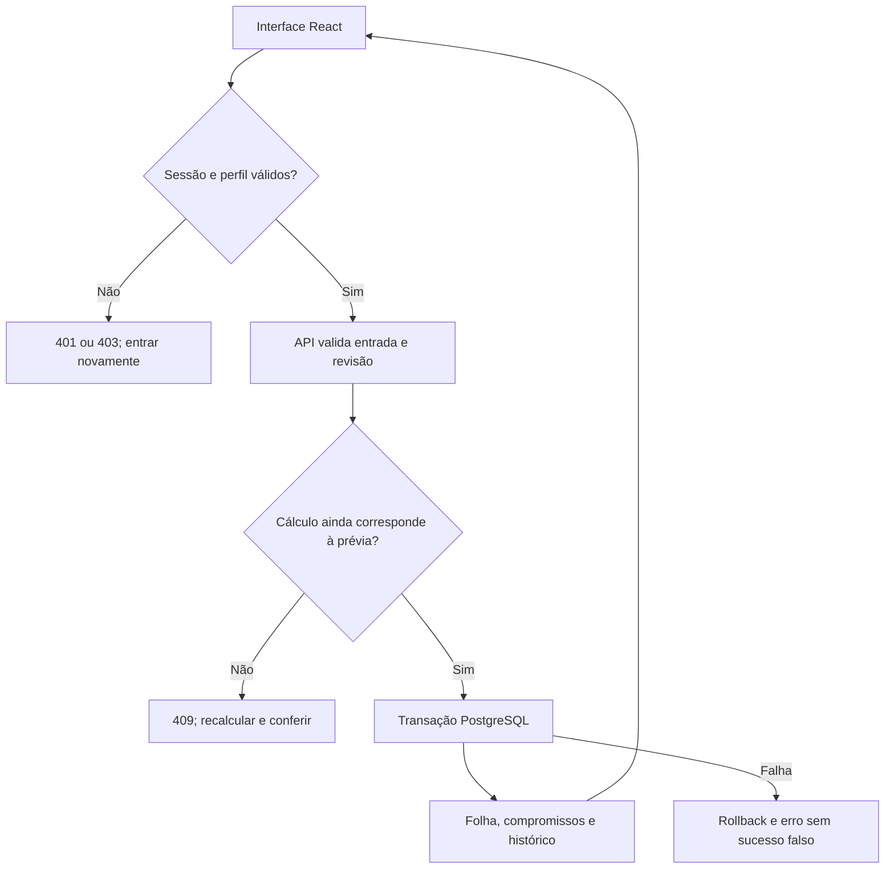
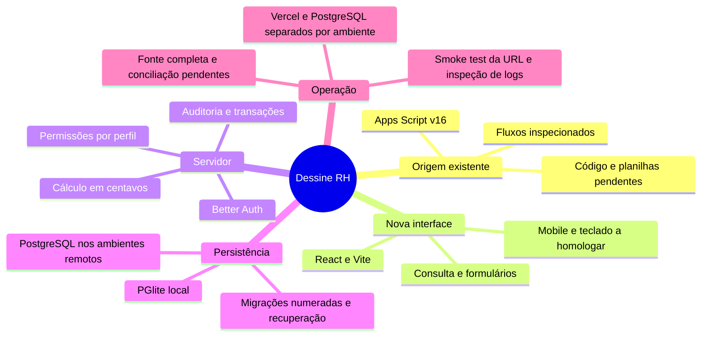

# Guia técnico, implantação e operação

## Estado e limite

O aplicativo Google Apps Script original foi inspecionado pela interface autenticada em 12/11/2026 e se identificou como **DP Dessine versão 16**. O código servidor, planilhas, permissões internas e política de backup da origem não foram disponibilizados. A auditoria da origem cobre fluxos e regras visíveis, sem certificar sua implementação interna.

A nova aplicação usa dados locais fictícios para validação. Nenhum funcionário, usuário, senha, folha ou pagamento real foi migrado pelo pacote. A origem permanece intacta. Não há sincronização automática entre as aplicações.

## Decisão de arquitetura

Objetivo: aplicação de backoffice autenticada, leve, com dados compartilhados, cálculos reproduzíveis e rastreabilidade. Restrição dominante: preservar regras do DP e proteger a integridade financeira em edições concorrentes. Aceite: fluxo completo validado com autenticação, banco persistente e teste real após implantação.

| Opção | Ganho | Custo e condição de escolha |
|---|---|---|
| React/Vite + Express + PostgreSQL — recomendada | Fronteiras simples, frontend estático, API transacional, fácil teste | Exige montar autenticação, ambiente e operação de banco |
| Next.js + PostgreSQL | Convenções integradas para páginas e servidor | Preferível se a equipe já usa Next ou precisa de conteúdo público/SSR; não é necessário para este painel |
| Manter Apps Script e substituir só a tela | Menor migração inicial | Exige acesso ao código e contrato de API; não foi confirmado que a origem expõe API adequada |

Premissa mais frágil: a migração para um banco novo atende melhor ao uso real do que preservar a planilha. Teste barato: obter o projeto Apps Script e a planilha, mapear contratos e reconciliar uma competência. Mudar a recomendação se a integração existente for confiável e a migração tiver custo desproporcional ao volume.

Não chamar a solução de escalável sem medir. Paginação, consultas com índices e transações são fundamentos; throughput, latência p95 e concorrência dependem de ambiente e banco reais.

### Fluxo proposto, implementado para validação local

### Responsabilidades e evidência pendente

## Ambientes

| Ambiente | Dados | Banco | Publicação |
|---|---|---|---|
| Testes automatizados | Fictícios, isolados | PGlite temporário | Não |
| Desenvolvimento local | Fictícios do seed | PGlite em `.data` | Não |
| Homologação remota | Fictícios ou anonimizados | PostgreSQL próprio | Preview controlado |
| Produção | Dados reais autorizados | PostgreSQL durável e backup | Domínio de produção |

`DATABASE_URL`, segredo de autenticação e senhas pertencem a variáveis privadas. Nunca usar prefixos públicos para segredos. Preview não deve apontar para o banco de produção. O seed de desenvolvimento não pode rodar em produção. Arquivos `.env`, `.data`, cookies, traces autenticados e dumps reais não entram no Git nem no pacote de entrega.

## Migração da origem

1. Obter acesso autorizado ao projeto Apps Script e à planilha correspondente, ou uma exportação completa controlada.
2. Registrar abas, colunas, identificadores, fórmulas, regras, usuários e períodos disponíveis. Não deduzir a base inteira a partir de uma tela.
3. Fazer cópia de segurança antes de qualquer alteração.
4. Criar mapa explícito de campos: funcionário → colaborador, cargo, admissão, salário base em centavos, utiliza VT, VT diário, situação e desligamento; falta → pessoa/data/desconto/autor; folha → competência/fotografia; pagamento → versão/origem/status/data/autor.
5. Validar tipos, datas, duplicatas, vínculos e totais em área de homologação. Não inserir silenciosamente valores padrão para informações faltantes.
6. Conciliar por competência: contagem de pessoas, base salarial, VA, VT, faltas, valores pendentes/pagos e datas previstas.
7. Importar de forma idempotente usando identificador da origem, transação e relatório. O importador completo é uma pendência; selecione um parser confiável caso se opte por CSV.
8. Não transportar hashes/senhas do sistema antigo sem contrato compatível. Criar contas individuais pelo fluxo administrativo e comunicar credenciais pelo canal adequado.
9. Definir a data de corte, evitar dupla escrita, conferir a conciliação e só então colocar a nova base em uso.

O pacote não contém exportação de dados reais. O acesso à interface original não equivale a acesso ao código nem à planilha.

## Banco e inicialização

`npm run db:migrate` aplica as migrações numeradas no banco indicado por `DATABASE_URL`. Aplique primeiro em uma cópia ou em homologação. Use uma conexão de administração com DDL para migração e uma credencial de aplicação sem DDL para as funções. Conceda a esta última acesso aos objetos que a API e o Better Auth usam, incluindo leitura de `schema_migrations`.

| Variável | Uso |
|---|---|
| `DATABASE_URL` | Conexão PostgreSQL privada com TLS quando exigido pelo provedor. Configure uma URL diferente por ambiente. |
| `BETTER_AUTH_SECRET` | Segredo privado e exclusivo por ambiente, com pelo menos 32 caracteres. |
| `BETTER_AUTH_URL` | Origem exata usada no navegador, com HTTPS nos ambientes Vercel. Use um domínio estável para a homologação e outro para produção. |
| `APP_ENV`, `PGLITE_DIR`, `PORT` | Desenvolvimento local. `APP_ENV=local` libera PGlite e o seed local. |
| `SEED_ADMIN_PASSWORD` | Senha descartável do usuário fictício local. |
| `DESSINE_ADMIN_USERNAME`, `DESSINE_ADMIN_NAME`, `DESSINE_ADMIN_PASSWORD` | Entradas transitórias do procedimento de acesso no terminal administrativo. |

Após migrar o banco, injete as três variáveis `DESSINE_ADMIN_*` por um gerenciador de segredos ou leia a senha sem exibi-la no terminal. Em PowerShell 7 use `$env:DESSINE_ADMIN_PASSWORD = Read-Host -MaskInput 'Senha inicial'`. Em Bash use `read -rs DESSINE_ADMIN_PASSWORD && export DESSINE_ADMIN_PASSWORD`. Execute `npm run db:admin -- bootstrap`. A transação cria a conta DP e seu evento de auditoria. Se já houver um DP ativo, a execução é idempotente. Remova as variáveis temporárias ao encerrar e transmita a credencial pelo canal interno de acesso. O painel não possui endpoint HTTP de inicialização.

Para recuperar uma conta DP ativa, use as credenciais de manutenção no terminal, informe o usuário e a nova senha e execute `npm run db:admin -- recover`. A recuperação altera a credencial, revoga sessões e grava um evento no banco. Valide o novo login em uma sessão limpa. Esse procedimento exige acesso de manutenção ao PostgreSQL.

## Publicação na Vercel

O usuário autorizou construir, validar e publicar. Essa autorização não equivale a permissão para contratar plano, domínio ou serviço com cobrança não combinada.

1. Conferir repositório, branch, commit, time e projeto. Preservar trabalho existente e usar checkout isolado quando necessário.
2. Inspecionar Vercel CLI/conector autenticado e projetos acessíveis. Não reutilizar projeto de outra finalidade.
3. Criar ou vincular projeto dedicado `dessine-rh` no time correto.
4. Provisionar ou conectar PostgreSQL com pool/conexão compatível com funções. Conferir plano, região, limites e custo; confirmar qualquer nova contratação.
5. Configurar variáveis privadas de banco e autenticação por ambiente; definir a URL confiável exata de autenticação. Não imprimir valores em logs.
6. Executar migração e criar administrador pelo procedimento seguro e idempotente.
7. Rodar testes locais e em PostgreSQL, build e auditoria de dependências; corrigir bloqueios concretos.
8. Criar implantação de homologação. Conferir login, perfis, cadastros, faltas, folha, pagamentos, exportação e estados de falha em navegador real.
9. Preparar implantação de produção e validar o mesmo artefato antes da promoção. Registrar commit, deployment ID, ambiente e resultados.
10. Abrir a URL final, executar smoke test autorizado com registros fictícios isolados, confirmar persistência após nova sessão e instância e registrar o resultado real.

O conector Vercel conseguiu consultar o time autorizado. A publicação funcional depende de um PostgreSQL acessível pela Vercel e de ambientes configurados. Verifique se o plano do time permite o uso empresarial e se a escolha de provedor e banco se enquadra no custo autorizado. Compartilhe somente os domínios verificados com o nome do projeto.

Express é suportado na Vercel. A documentação oficial informa que os assets devem estar em `public/`; `express.static` é ignorado no deploy. O Vite gera o frontend nessa pasta. Confira a configuração da plataforma na data de implantação.

## Backup, recuperação e continuidade

- Definir responsável, periodicidade, retenção e localização dos backups conforme o volume e a política da empresa.
- Usar mecanismo do provedor PostgreSQL e, quando apropriado, exportação lógica criptografada. Não anexar dumps reais a issues, conversas ou repositórios públicos.
- Estabelecer RPO e RTO com os responsáveis; nenhum valor foi contratado ou medido nesta etapa.
- Para uma cópia lógica, use `pg_dump --format=custom --no-owner --file=dessine.dump` com uma conexão injetada no ambiente do cliente PostgreSQL. Armazene o arquivo criptografado. Restaure em um banco PostgreSQL vazio e separado com `pg_restore --exit-on-error --no-owner --no-privileges --dbname=dessine_restore dessine.dump`, com host e credenciais de destino definidos no ambiente. Confira contagens, permissões e totais de uma competência conhecida. Para um ambiente usado por pessoas, revogue as sessões copiadas antes de liberar o acesso.
- Reverter deploy restaura código, mas não desfaz migração de banco. Toda migração precisa de plano compatível com a versão anterior ou procedimento explícito de recuperação.
- Desativação de usuário e troca de senha devem revogar sessões conforme o caso. Estabelecer procedimento de recuperação de acesso e saída de colaborador.

## Monitoramento e privacidade operacional

Monitorar disponibilidade de `/api/health`, erros 5xx, falhas do banco, rejeições 409, latência e uso da infraestrutura. Registrar somente metadados necessários. Não enviar senhas, cookies, salários, nomes completos ou observações de faltas para serviços de analytics ou logs.

Histórico de negócio e logs técnicos têm propósitos distintos. O histórico precisa identificar o autor das alterações; logs técnicos podem referir identificadores sem replicar o conteúdo do RH. O histórico implementado não deve ser chamado de imutável contra administrador do banco.

## Aceite exigido antes de declarar concluído

| Área | Critério |
|---|---|
| Acesso | Login/logout/expiração, conta desativada, rejeição de senha incorreta |
| Permissão | Consulta permitida para financeiro/diretoria; escrita bloqueada na API |
| Privacidade | Nenhum dado de RH em resposta pública, bundle, cache público ou logs |
| Cadastros | Criar/editar/inativar, validar datas/centavos e conflito de versão |
| Faltas | Duplicata recusada, sem desconto não reduz benefício, anulação auditada |
| Cálculo | Regressão da origem, feriados, ano bissexto, admissão/desligamento, limites |
| Fechamento | Prévia desatualizada recusada, fechamento único, snapshot preservado |
| Pagamentos | Registro/reversão com motivo, sem transferência real, reabertura protegida |
| Concorrência | Alterações simultâneas não duplicam folha nem perdem dados |
| Persistência | Dados disponíveis após nova sessão, reinício e nova instância |
| Interface | Desktop e celular, teclado, foco, rótulos, erros/vazios/carregamento |
| Exportação | CSV correto, fórmula neutralizada, impressão legível |
| Operação | Backup restaurado em homologação, rollback documentado |
| Deploy | URL final aberta e verificada; logs e commit correspondem ao artefato |

Testar cada fronteira real. Build aprovado não comprova autenticação, banco remoto, acessibilidade ou uso em produção.

## Fontes técnicas primárias

- [Express na Vercel](https://vercel.com/docs/frameworks/backend/express)
- [Limites e uso do plano Hobby](https://vercel.com/docs/plans/hobby)
- [Node.js 24 na Vercel](https://vercel.com/changelog/node-js-24-lts-is-now-generally-available-for-builds-and-functions)
- [Better Auth: opções](https://better-auth.com/docs/reference/options)
- [Better Auth: username](https://better-auth.com/docs/plugins/username)
- [Better Auth: administração](https://better-auth.com/docs/plugins/admin)
- [Better Auth: adaptador Drizzle](https://better-auth.com/docs/adapters/drizzle)

Essas referências orientaram o desenho. A configuração final e as versões devem ser conferidas pelo Codex no checkout e na implantação reais.
